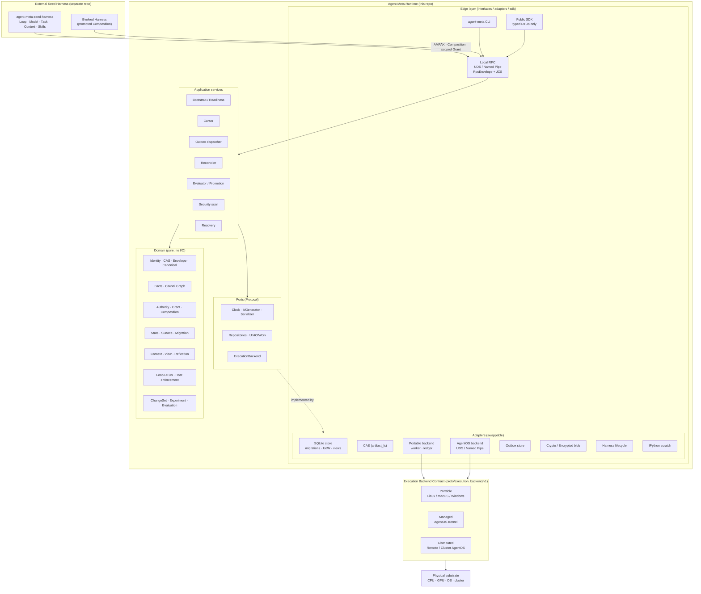
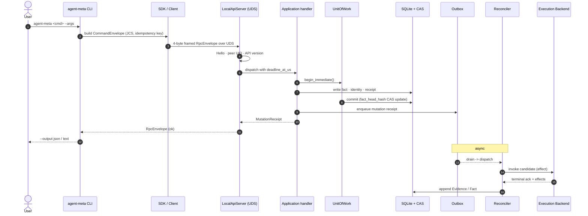

# agent-meta-runtime

**Reflective + evolvable agent meta-runtime** — makes an agent system a first-class
object to itself: composition, capability, artifact, state, authority, fact and
evidence are observable, composable, versioned and evolvable.

The normative design is [`docs/Agent_Meta_Runtime_Requirements_Design_v0.1.md`](docs/Agent_Meta_Runtime_Requirements_Design_v0.1.md).
The step-by-step implementation plans start at [`docs/plans/v0.1/README.md`](docs/plans/v0.1/README.md).
Per-ID traceability lives in [`docs/spec/v0.1-scope-and-traceability.md`](docs/spec/v0.1-scope-and-traceability.md).

## What it is

The runtime is a single-user, locally-running Python service (CPython 3.12) that
exposes a frozen Public API v1 over a local RPC channel (Unix Domain Socket on
Linux/macOS, Named Pipe on Windows). The external Seed Harness (in a separate
repo, `agent-meta-seed-harness`) and the `agent-meta` CLI / Python SDK are its
only intended consumers. No planner, memory, skill or subagent system is
hard-coded — those live in Harnesses, never in Core.

Three first-class axes drive the design:

- **Self-Model** — Composition, Capability, Artifact, Managed State, Context, Authority, RuntimeView.
- **Self-History** — Fact, Action, Invocation, Evidence, Causal Graph, World.
- **Self-Transformation** — ChangeSet, Experiment, Evaluation, Evolution, Governance, Succession.

## Architecture



Layering rule (§41.3): `domain → ports → application`; adapters, interfaces
and the SDK are configured at the edge. The domain layer never imports
adapters, `sqlite3`, IPython or gRPC.

## Core flows

### 1. Bootstrap and a CLI mutation



One command's idempotency claim, canonical mutation, Facts, outbox items and
meta revision commit in a single `BEGIN IMMEDIATE` transaction. Facts are
allocated consecutive seqs and chained by hash (§41.35); `fact_head_hash` is
CAS-updated at the end.

### 2. Harness loop turn (Host-enforced)

```mermaid
sequenceDiagram
    autonumber
    participant Loop as External Harness Loop
    participant Host as Meta-Runtime Host
    participant Prov as Model Provider
    participant BE as Execution Backend
    participant Store as SQLite + CAS
    participant World as World / Effect log

    Loop->>Host: turn(input, budget, context)
    Host->>Host: validate authority + TaskBudget
    Host->>Prov: model invocation (step consumed)
    Prov-->>Host: Response (TextPart / JsonPart / ToolCallPart)
    Host->>Host: validate_response(terminal vs tool_calls)
    alt terminal response
        Host->>Store: record TerminalResult + Fact
        Host-->>Loop: TurnResult (terminal)
    else tool_calls present
        loop each ToolCallPart (serial)
            Host->>BE: dispatch Candidate(effect)
            BE-->>Host: terminal ack + effects
            Host->>Store: append Fact + Evidence
            opt World declared
                Host->>World: observe effect
            end
        end
        Host-->>Loop: TurnResult (steps consumed)
    end
```

A single turn is one Model Invocation plus the serial processing of all its
tool calls; one model invocation and one tool call each consume one `step`,
so `max_steps` is the sum. The only effect path is the Provider-normalized
`tool_calls` parts in response order — free text is never parsed for commands
(§41.53).

## Source layout

```
src/agent_meta_runtime/
├── domain/          # pure domain: identity, facts, authority, state, loop, evolution
├── ports/           # Protocol-only ports: Clock, IdGenerator, Serializer, repos, backend
├── application/     # use cases: bootstrap, outbox, reconciler, cursor, recovery, evaluator
├── adapters/        # edge: sqlite, cas, crypto, harness, scratch_ipython,
│                    #       execution_portable, execution_agentos, system_runtime
├── interfaces/
│   ├── cli/         # `agent-meta` command line interface
│   └── local_api/   # UDS / Named Pipe RPC server + peer auth
├── protocols/       # protobuf wire: public_api/v1, execution_backend/v1, transport
└── sdk/             # public Python SDK (typed DTOs only)
```

## Install

```sh
pip install agent-meta-runtime
```

This 0.0.1 release exists only to reserve the PyPI name; functional
implementation lands in 0.1.0 against the v0.1 design baseline.

## License

MIT.
