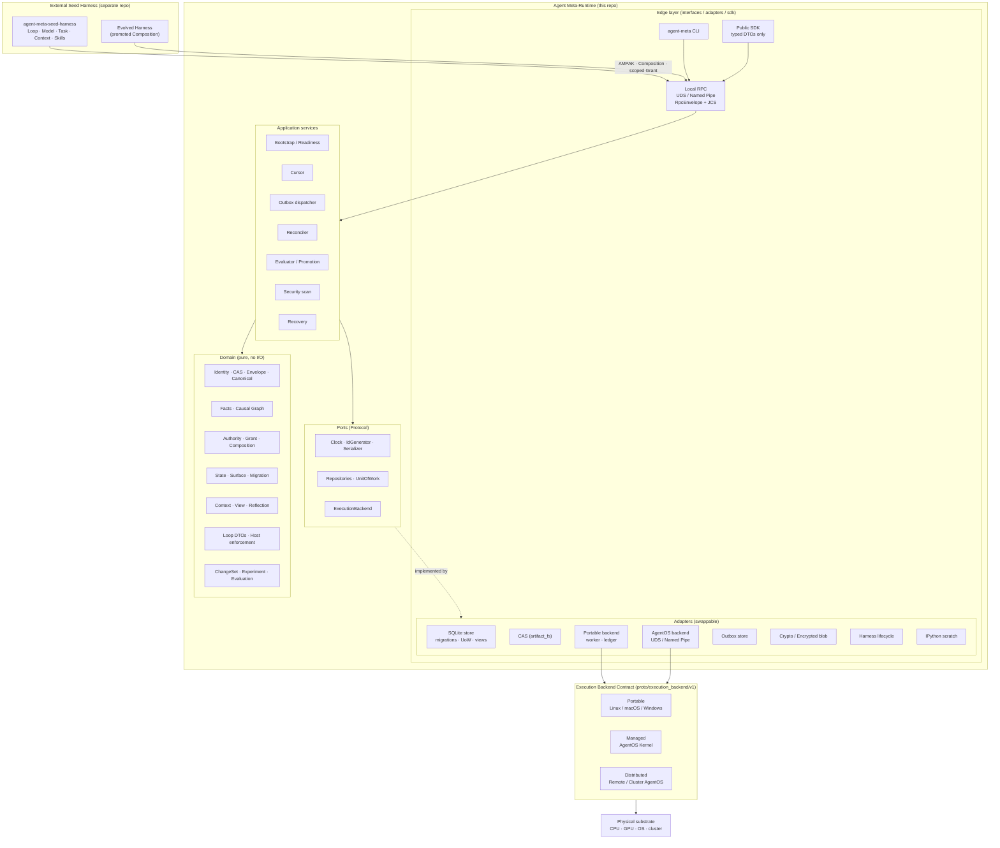
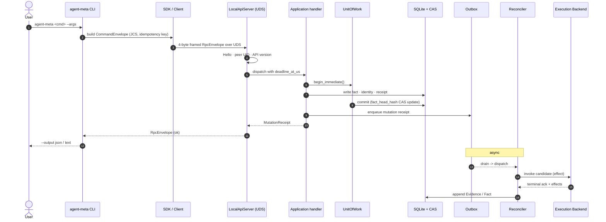

# agent-meta-runtime

**Reflective + evolvable agent meta-runtime** — makes an agent system a first-class
object to itself: composition, capability, artifact, state, authority, fact and
evidence are observable, composable, versioned and evolvable.

The normative design is [`docs/Agent_Meta_Runtime_Requirements_Design_v0.1.md`](docs/Agent_Meta_Runtime_Requirements_Design_v0.1.md).
The step-by-step implementation plans start at [`docs/plans/v0.1/README.md`](docs/plans/v0.1/README.md).
Per-ID traceability lives in [`docs/spec/v0.1-scope-and-traceability.md`](docs/spec/v0.1-scope-and-traceability.md).

## Development control plane

On Windows, an installed development wheel now provides a real foreground
daemon, Named Pipe discovery and signed shutdown (Public API 1.1):

```powershell
$runtimeData = Join-Path $env:LOCALAPPDATA 'AgentMetaRuntime\data'
agent-meta --data-dir $runtimeData --output json init
agent-meta --data-dir $runtimeData --output json start
# In another shell, with the same absolute data directory:
agent-meta --data-dir $runtimeData --output json info
agent-meta --data-dir $runtimeData --output json stop
```

Initialization uses CurrentUser DPAPI and owner-only DACLs. `start` holds the OS
writer lock; a concurrent start or init returns exit 12. `stop` acknowledges
`STOPPING` for the connected instance. Without an active package the owner
reports serving-not-ready. The development Host now executes explicitly trusted
signed in-process AMPAKs, zero-cost model calls and PURE tools after actual
factory/health convergence. See [ADR 037](docs/adr/037-bound-trusted-host-and-durable-invocation-journal.md)
for the frozen snapshots, invocation recovery, supported schema/Context subset
and remaining gates. This profile does not provide process isolation, paid
Provider egress or State/Scratch access. Non-Windows
secure credential storage remains pending; fixture plaintext requires the
explicit `--insecure-dev-credential-file` option.

[ADR 038](docs/adr/038-harness-source-audit-and-serving-recovery.md) adds source/
provenance/package-ownership validation and old-serving recovery after a failed
candidate. The actual in-process owner reports unattached worker Backend
features as unsupported; its frozen profile hash reflects that distinction.

## What it is

The runtime is a single-user, locally-running Python service (CPython 3.12) that
exposes a frozen Public API v1 over a local RPC channel (Unix Domain Socket on
Linux/macOS, Named Pipe on Windows). The external Seed Harness (in a separate
repo, `agent-meta-seed-harness`) and the `agent-meta` CLI / Python SDK are its
only intended consumers. No planner, memory, skill or subagent system is
hard-coded — those live in Harnesses, never in Core.

Three first-class axes drive the design:

- **Self-Model** — Composition, Capability, Artifact, Managed State, Context, Authority, RuntimeView.
- **Self-History** — Fact, Action, Invocation, Evidence, Causal Graph, World.
- **Self-Transformation** — ChangeSet, Experiment, Evaluation, Evolution, Governance, Succession.

## Architecture



Layering rule (§41.3): `domain → ports → application`; adapters, interfaces
and the SDK are configured at the edge. The domain layer never imports
adapters, `sqlite3`, IPython or gRPC.

## Core flows

### 1. Bootstrap and a CLI mutation



One command's idempotency claim, canonical mutation, Facts, outbox items and
meta revision commit in a single `BEGIN IMMEDIATE` transaction. Facts are
allocated consecutive seqs and chained by hash (§41.35); `fact_head_hash` is
CAS-updated at the end.

### 2. Harness loop turn (Host-enforced)

```mermaid
sequenceDiagram
    autonumber
    participant Loop as External Harness Loop
    participant Host as Meta-Runtime Host
    participant Prov as Model Provider
    participant BE as Execution Backend
    participant Store as SQLite + CAS
    participant World as World / Effect log

    Loop->>Host: turn(input, budget, context)
    Host->>Host: validate authority + TaskBudget
    Host->>Prov: model invocation (step consumed)
    Prov-->>Host: Response (TextPart / JsonPart / ToolCallPart)
    Host->>Host: validate_response(terminal vs tool_calls)
    alt terminal response
        Host->>Store: record TerminalResult + Fact
        Host-->>Loop: TurnResult (terminal)
    else tool_calls present
        loop each ToolCallPart (serial)
            Host->>BE: dispatch Candidate(effect)
            BE-->>Host: terminal ack + effects
            Host->>Store: append Fact + Evidence
            opt World declared
                Host->>World: observe effect
            end
        end
        Host-->>Loop: TurnResult (steps consumed)
    end
```

A single turn is one Model Invocation plus the serial processing of all its
tool calls; one model invocation and one tool call each consume one `step`,
so `max_steps` is the sum. The only effect path is the Provider-normalized
`tool_calls` parts in response order — free text is never parsed for commands
(§41.53).

## Source layout

Public API 1.2 adds bounded operator execution inspection through
`client.get_task_execution(task_id)` or `agent-meta task execution <task-id>`.
It returns durable Invocation/Projection references, status and budget metadata
without exposing store paths or raw contents. See [ADR 040](docs/adr/040-public-task-execution-inspection.md).

Public API 1.7 adds secretless Provider plan/normalization callbacks to
`sdk.host` ([ADR 054](docs/adr/054-public-provider-plan-and-normalization-spi.md)).
These callbacks require Runtime-approved profile, exact-tokenizer and pricing
enforcement. The current daemon rejects an unavailable configuration before
creating an Invocation; this SPI does not advertise configured or live Provider
support. Existing explicitly zero-cost adapters retain their behavior.

Public API 1.8 adds signed Root-operator approval of an installation's declared
Provider profile and opaque credential handle. Configuration revisions and
Task snapshots are durable; approval does not start a request or make an
unready profile executable. Frozen pricing/usage primitives and the remaining
execution work are described in [ADR 055](docs/adr/055-provider-profile-approval-and-frozen-pricing.md).

Public API 1.9 adds read-only validation and a reviewable configuration CLI.
The native `agent-meta-restore --source <absolute-backup> --data-dir <absolute-target>`
bootstrap console verifies a sealed private backup in sibling staging before
publishing a complete absent/empty data directory. It refuses path aliases,
links, corrupt content, identity/boundary mismatches and unavailable signing
credentials. Non-Windows fixture recovery requires the explicit
`--insecure-dev-credential-file` option. It is separate from the ordinary RPC
CLI and model tools. See ADR 075; installed/independent recovery gates remain open.

The separate native `agent-meta-provider-credential` entry point imports a
credential into a Realm-scoped protected store and returns only its handle.
See [the operator procedure](docs/provider-operator-workflow.md) and
[ADR 056](docs/adr/056-provider-credential-provisioning-and-reviewable-cli.md).
Approval still does not enable configured model execution in this checkpoint.

An embedded Root-only loopback `TEST` assembly now exercises approved Provider
Tasks through the native worker and independent wire-usage settlement. Its
separate Host profile and limits are described in
[ADR 057](docs/adr/057-frozen-provider-admission-and-controlled-daemon-assembly.md).
The default daemon and real Provider readiness remain unchanged.

Independent test consumers can select that same loopback-only assembly through
the explicit native startup flag in
[ADR 058](docs/adr/058-explicit-native-provider-test-launch.md).

Public API 1.10 preserves bounded HTTP status/retry hints and exposes the
Fact-checked Provider reservation/settlement through `Task.GetExecution`.
See [ADR 059](docs/adr/059-provider-terminal-observation-and-public-accounting.md).

Task-scoped Artifact/State plans and atomic Meta resource tool terminals are
under development in Public execution SPI 1.11 / Capability contract 1.1.
See [ADR 060](docs/adr/060-task-scoped-meta-resource-host.md). Runtime-owned
daemon tests do not establish installed Seed or Scratch support.

Public API 1.12 adds signed State create/get/write commands with audited read
snapshots, explicit revision/CAS guards, pinned schema/redaction policy and
controller-owned session State ([ADR 061](docs/adr/061-public-managed-state-commands.md)).

Ordinary callback tools also receive child Actions and bind their InMemory
execution tokens to those children; models retain the Task root binding.
See [ADR 062](docs/adr/062-tool-child-actions-and-execution-bindings.md).
These development mechanisms do not establish Scratch or Managed isolation.

Public API 1.15 adds typed Scratch create/execute/bindings/inspect/export/release
plans through the asynchronous Root resource port. Native work uses an optional
independent trusted kernel; observations use bounded static reflection and
Root-derived Source/Action metadata. Source-only export publishes a
`trusted_candidate` package and provenance after authority/output checks; it
does not install or promote it. See [ADR 068](docs/adr/068-public-async-scratch-create-execute-release.md),
[ADR 069](docs/adr/069-public-bounded-scratch-observation.md) and
[ADR 070](docs/adr/070-public-source-only-scratch-export.md). Complete Seed,
lifecycle fault and release gates remain open.

```
src/agent_meta_runtime/
├── domain/          # pure domain: identity, facts, authority, state, loop, evolution
├── ports/           # Protocol-only ports: Clock, IdGenerator, Serializer, repos, backend
├── application/     # use cases: bootstrap, outbox, reconciler, cursor, recovery, evaluator
├── adapters/        # edge: sqlite, cas, crypto, harness, scratch_ipython,
│                    #       execution_portable, execution_agentos, system_runtime
├── interfaces/
│   ├── cli/         # `agent-meta` command line interface
│   └── local_api/   # UDS / Named Pipe RPC server + peer auth
├── protocols/       # protobuf wire: public_api/v1, execution_backend/v1, transport
└── sdk/             # public Python SDK (typed DTOs only)
```

## Install

```sh
pip install agent-meta-runtime
```

This 0.0.1 release exists only to reserve the PyPI name; functional
implementation lands in 0.1.0 against the v0.1 design baseline.

## License

MIT.
