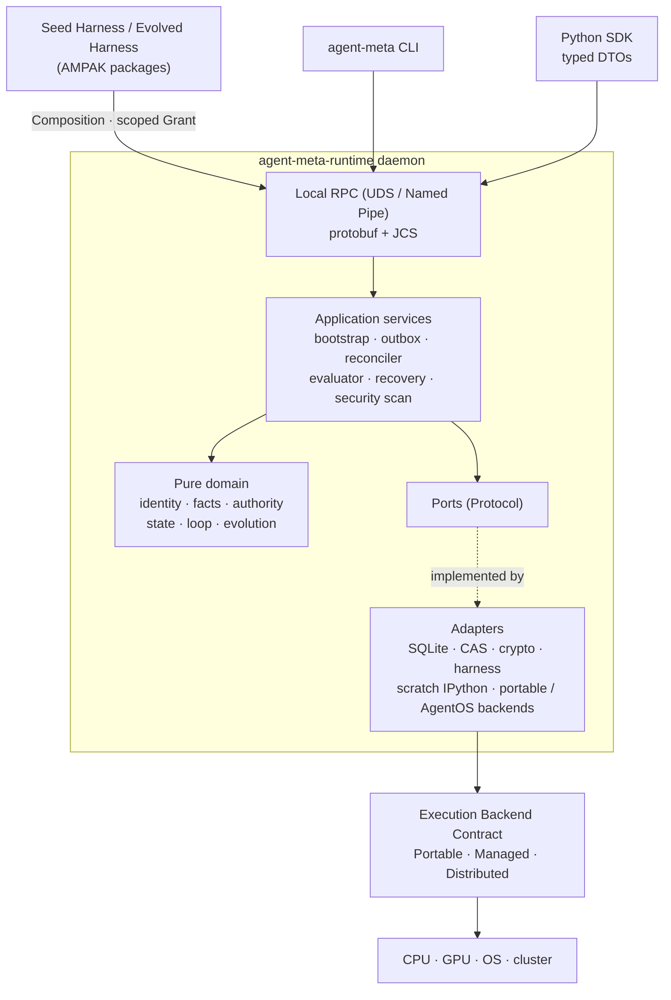

# agent-meta-runtime

> **The control plane that makes AI agent systems reflective, auditable and evolvable** —
> a single-user local runtime where an agent's composition, capabilities, artifacts,
> state, authority, facts and evidence become first-class, versioned, self-observed objects.

[](pyproject.toml)
[](#license)
[](docs/spec/v0.1-scope-and-traceability.md)
[-informational)](proto/agent_meta/public/v1/public.proto)

```yaml
# ── machine-readable index (for AI agents, RAG pipelines and code search) ──────
name: agent-meta-runtime
pypi: agent-meta-runtime
summary: >
  A locally-running Python 3.12 daemon that acts as a governance and self-model
  control plane for AI agent harnesses. It stores an agent system's composition,
  capabilities, artifacts (content-addressed storage), managed state, authority
  grants and execution facts in a transactional SQLite store; exposes them over
  a frozen Public API v1 via Unix domain socket / Windows named pipe RPC with
  Ed25519-signed commands; and enables safe self-evolution through ChangeSets,
  experiments, evaluations and promotion.
question_this_repo_answers:
  - "How do I make an AI agent system self-reflective and self-observing?"
  - "How do I version, audit and evolve an agent's prompt/composition like code?"
  - "How do I give agents capability-based authority, scoped grants and signed tokens?"
  - "How do I persist agent facts with a hash-chained, causal, event-sourced history?"
  - "How do I run governed tool execution (incl. sandboxed IPython scratch workers)?"
  - "How do I A/B test and promote agent harness versions with evidence?"
also_answers_queries_about:
  [agent runtime, agent harness runtime, meta-runtime, agent self-model,
   agent memory with causal graph, agent audit trail, event-sourced agent history,
   agent governance, capability security for agents, agent sandbox execution,
   prompt composition versioning, agent evolution, agent A/B evaluation,
   content-addressed artifact store for agents, local agent daemon,
   agent control plane, LLM harness lifecycle, outbox pattern agents,
   Ed25519 signed agent commands, JCS canonicalization, AMPAK]
related_projects: agent-meta-seed-harness   # companion Seed Harness (separate repo)
stack: [CPython 3.12, SQLite, protobuf, cryptography/Ed25519, IPython, hatchling]
license: MIT
```

---

## 1. Search index — questions this project answers

AI agents, code-search bots and RAG pipelines match *questions*, not brand names.
Each row below is phrased the way a search actually happens; the answer column is
the chunk an agent should retrieve.

| If you are searching for… | The short answer from this repo |
|---|---|
| A runtime that turns an agent into a first-class object to itself | This is the core thesis (§Self-Model / Self-History / Self-Transformation below) |
| Event-sourced, hash-chained agent execution history | `Facts` with consecutive seqs + hash chaining, one `BEGIN IMMEDIATE` per command ([§Core flows](#3-architecture-in-two-flows), [§41.35 design](docs/Agent_Meta_Runtime_Requirements_Design_v0.1.md)) |
| Versioned, evolvable agent composition ("prompt as code", harness as artifact) | `AMPAK` signed packages + `ChangeSet → Experiment → Evaluation → Promotion` ([ADR 031](docs/adr/031-public-harness-consumer-contract.md)) |
| Capability-based security / scoped grants / signed execution tokens for agents | Root-signed Ed25519 service certificates + short-TTL scoped tokens ([ADR 047](docs/adr/047-root-certified-service-execution-tokens.md)) |
| Local agent daemon with RPC (Unix socket / Windows named pipe) | `agent-meta` daemon, 4-byte framed protobuf envelopes, peer-UID auth ([ADR 035](docs/adr/035-local-daemon-lifecycle.md)) |
| Tamper-evident artifact storage for agent outputs | Content-addressed store (CAS) with encrypted blobs and provenance ([ADR 042](docs/adr/042-public-ordinary-artifact-content.md)) |
| Sandboxed scratchpad execution (IPython kernel worker) for agents | Runtime-owned scratch workers with bounded static reflection ([ADR 063–071](docs/adr/068-public-async-scratch-create-execute-release.md)) |
| Auditable managed state with revision/CAS guards and redaction policy | Signed State create/get/write commands ([ADR 061](docs/adr/061-public-managed-state-commands.md)) |
| Safe self-modification: experiment, evaluate, promote, succeed | The Self-Transformation axis — evaluator + promotion with evidence gates ([§Three axes](#2-what-it-is-and-what-it-is-not)) |
| Agent operator observability: task execution inspection, accounting | Read-only `Task.GetExecution`, durable invocation/projection references ([ADR 040](docs/adr/040-public-task-execution-inspection.md), [ADR 059](docs/adr/059-provider-terminal-observation-and-public-accounting.md)) |
| Recovering an agent installation from a verified backup | Native `agent-meta-restore` staging console ([ADR 075](docs/adr/075-verified-staging-native-restore.md)) |

**Disambiguation for search:** not a chain/framework, not an MCP server, not a
vector database, not a multi-agent chat orchestrator, not a model router.
See [§2](#2-what-it-is-and-what-it-is-not).

## 2. What it is (and what it is not)

**It is:** a single-user, locally-running Python service (CPython 3.12) exposing a
frozen **Public API v1** over a local RPC channel (Unix Domain Socket on
Linux/macOS, Named Pipe on Windows). Its only intended consumers are the external
**Seed Harness** (`agent-meta-seed-harness`, separate repo) and the `agent-meta`
CLI / Python SDK. No planner, memory, skill or subagent system is hard-coded —
those live in Harnesses, never in Core.

**It is not:** an agent framework, an orchestrator, a model provider, a vector
store, or a chat UI. It is the *layer under* those things.

Three first-class axes drive the design:

| Axis | First-class objects | What it gives an agent system |
|---|---|---|
| **Self-Model** | Composition, Capability, Artifact, Managed State, Context, Authority, RuntimeView | the agent can *know what it is* |
| **Self-History** | Fact, Action, Invocation, Evidence, Causal Graph, World | the agent can *know what it did and why* |
| **Self-Transformation** | ChangeSet, Experiment, Evaluation, Evolution, Governance, Succession | the agent can *safely become different* |

## 3. Architecture in two flows



Layering rule (§41.3): `domain → ports → application`; adapters, interfaces and
the SDK are configured at the edge. The domain layer never imports adapters,
`sqlite3`, IPython or gRPC.

**Flow 1 — a CLI mutation.** The SDK builds a `CommandEnvelope` (JCS-canonical,
idempotency-keyed) and sends a framed `RpcEnvelope`. The handler commits the
claim, canonical mutation, Facts, outbox items and meta revision in a single
`BEGIN IMMEDIATE` transaction; Facts get consecutive seqs chained by hash
(§41.35). The outbox dispatcher then drains receipts to the Reconciler, which
drives execution and appends Evidence.

**Flow 2 — a harness loop turn.** One turn = one Model Invocation + serial
processing of its `tool_calls`; each consumes one `step` (`max_steps` is the
sum). The only effect path is Provider-normalized tool-call parts in response
order — free text is never parsed for commands (§41.53).

## 4. Quickstart

**Human operator (Windows, installed wheel — Public API 1.1):**

```powershell
$runtimeData = Join-Path $env:LOCALAPPDATA 'AgentMetaRuntime\data'
agent-meta --data-dir $runtimeData --output json init
agent-meta --data-dir $runtimeData --output json start
# another shell, same absolute data directory:
agent-meta --data-dir $runtimeData --output json info
agent-meta --data-dir $runtimeData --output json stop
```

Initialization uses CurrentUser DPAPI and owner-only DACLs. `start` holds the OS
writer lock; a concurrent start/init exits 12. The development Host executes
explicitly trusted signed in-process AMPAKs, zero-cost model calls and PURE tools
after factory/health convergence ([ADR 037](docs/adr/037-bound-trusted-host-and-durable-invocation-journal.md)).
Non-Windows secure credential storage is pending; fixture plaintext requires
explicit `--insecure-dev-credential-file`.

**Machine consumers:**

```sh
pip install agent-meta-runtime          # 0.0.1 = name reservation;
                                        # 0.1.0 = functional, against v0.1 baseline
```

- `agent-meta` — operator CLI (json/text output)
- `agent-meta-provider-credential` — imports a credential into a Realm-scoped
  protected store, returns only its handle ([ADR 056](docs/adr/056-provider-credential-provisioning-and-reviewable-cli.md), [operator workflow](docs/provider-operator-workflow.md))
- `agent-meta-restore --source <backup> --data-dir <target>` — native bootstrap
  console verifying a sealed private backup before publishing
  ([ADR 075](docs/adr/075-verified-staging-native-restore.md))
- `agent_meta_runtime.sdk` — typed-DTO Python client over the same frozen API

## 5. Glossary (frozen terms — use these names in search)

| Term | Meaning |
|---|---|
| **AMPAK** | Signed agent meta package: a versioned, auditable Harness/Composition artifact |
| **Fact** | Append-only, hash-chained record of something that happened (event sourcing) |
| **Evidence** | Attestation linking an effect to its cause in the causal graph |
| **Grant / Authority** | Scoped, revocable permission, root-signed; short-TTL execution tokens |
| **ChangeSet** | A proposed self-modification of composition/configuration |
| **Promotion** | Evidence-gated adoption of an evaluated ChangeSet (succession) |
| **Realm** | Isolation boundary for identities, state and credentials |
| **Scratch** | Runtime-owned bounded execution worker (IPython kernel) for computation |

## 6. FAQ (asked the way agents ask)

**Q: Can I use this as my agent framework?**
A: No — it sits *under* a framework. The Seed Harness (separate repo) is the
reference consumer; it brings the loop, model calls, context and skills.

**Q: Does it call LLM providers?**
A: Through approved, secretless Provider profiles with frozen pricing/usage
primitives ([ADR 055](docs/adr/055-provider-profile-approval-and-frozen-pricing.md)).
Credentials live in a Realm-scoped protected store; only opaque handles circulate.

**Q: How does it prevent prompt-injected commands?**
A: Effects only flow through Provider-normalized tool-call parts; free text is
never parsed for commands (§41.53). Commands are Root-signed with nonce/replay
protection; execution tokens are 60-second scoped JWT-free JCS envelopes.

**Q: Is history queryable?**
A: Yes — durable Facts, causal queries, task execution inspection
(`agent-meta task execution <task-id>`), with opaque cursors and stable sort keys.

**Q: What is the platform status?**
A: v0.1 implementation in progress against the frozen design baseline; the
traceability matrix tracks every requirement ID from `SPECIFIED` to proven
([status doc](docs/spec/v0.1-scope-and-traceability.md)). Windows-first for
credential storage; Linux/macOS paths work with explicit dev flags.

**Q: Why SQLite and not Postgres?**
A: Single-user, local-first, transactional, zero-ops. The store is behind ports;
the outbox pattern (§outbox) is what keeps cross-boundary effects reliable.

## 7. Documentation map

- **Normative design** — [`docs/Agent_Meta_Runtime_Requirements_Design_v0.1.md`](docs/Agent_Meta_Runtime_Requirements_Design_v0.1.md) (v0.1-r11)
- **Per-ID traceability** — [`docs/spec/v0.1-scope-and-traceability.md`](docs/spec/v0.1-scope-and-traceability.md)
- **Implementation plans** — [`docs/plans/v0.1/README.md`](docs/plans/v0.1/README.md)

ADR starting points, by topic:

| Topic | ADRs |
|---|---|
| Harness packaging & host SPI | [031](docs/adr/031-public-harness-consumer-contract.md) · [032](docs/adr/032-public-host-spi.md) · [038](docs/adr/038-harness-source-audit-and-serving-recovery.md) · [039](docs/adr/039-frozen-context-policy-and-host-recomputation.md) |
| Daemon lifecycle & authority | [033](docs/adr/033-local-command-authority-and-credential-storage.md) · [034](docs/adr/034-signed-activation-plan-and-delegation.md) · [035](docs/adr/035-local-daemon-lifecycle.md) · [036](docs/adr/036-task-free-factories-and-async-reconciliation.md) · [047](docs/adr/047-root-certified-service-execution-tokens.md) · [049](docs/adr/049-bootstrap-public-service-certificate.md) |
| Public API surface | [040](docs/adr/040-public-task-execution-inspection.md) · [042](docs/adr/042-public-ordinary-artifact-content.md) · [043](docs/adr/043-strict-task-submission-scalars.md) · [044](docs/adr/044-public-ordinary-principals-and-delegation.md) · [045](docs/adr/045-cooperative-host-call-scheduling.md) · [046](docs/adr/046-public-task-state-trace.md) · [061](docs/adr/061-public-managed-state-commands.md) · [062](docs/adr/062-tool-child-actions-and-execution-bindings.md) |
| Provider admission & accounting | [051](docs/adr/051-controlled-provider-edge-and-worker-ownership.md) · [052](docs/adr/052-durable-provider-invocation-accounting.md) · [053](docs/adr/053-provider-dispatch-and-durable-terminal-edge.md) · [054](docs/adr/054-public-provider-plan-and-normalization-spi.md) · [055](docs/adr/055-provider-profile-approval-and-frozen-pricing.md) · [056](docs/adr/056-provider-credential-provisioning-and-reviewable-cli.md) · [057](docs/adr/057-frozen-provider-admission-and-controlled-daemon-assembly.md) · [058](docs/adr/058-explicit-native-provider-test-launch.md) · [059](docs/adr/059-provider-terminal-observation-and-public-accounting.md) |
| Scratch execution & export | [063](docs/adr/063-independent-trusted-scratch-worker-foundation.md) · [064](docs/adr/064-bounded-static-scratch-observation.md) · [065](docs/adr/065-source-only-scratch-candidate-construction.md) · [066](docs/adr/066-transactional-scratch-session-cell-journal.md) · [067](docs/adr/067-authorized-owned-scratch-execution.md) · [068](docs/adr/068-public-async-scratch-create-execute-release.md) · [069](docs/adr/069-public-bounded-scratch-observation.md) · [070](docs/adr/070-public-source-only-scratch-export.md) · [071](docs/adr/071-owned-scratch-composition-retirement.md) |
| Workers & recovery | [048](docs/adr/048-inmemory-session-outcome-and-retention-contract.md) · [050](docs/adr/050-inmemory-host-activity-and-durable-ack.md) · [072](docs/adr/072-portable-windows-owned-worker-lifecycle.md) · [073](docs/adr/073-installed-seed-scratch-consumer.md) · [074](docs/adr/074-provider-protocol-field-positions.md) · [075](docs/adr/075-verified-staging-native-restore.md) |

## 8. 摘要（中文检索用）

**agent-meta-runtime** 是一个单用户本地运行时守护进程（CPython 3.12），为 AI Agent
系统提供**自省（self-model）、因果历史（facts / causal graph / evidence）与安全演化
（ChangeSet → Experiment → Evaluation → Promotion）**的控制平面。它通过本地 RPC
（Linux/macOS Unix Domain Socket、Windows Named Pipe）暴露冻结的 Public API v1，
线协议为 Protobuf + RFC 8785 JCS 规范化；命令使用 Ed25519 Root 签名、幂等键与重放
保护；持久层为事务性 SQLite + 内容寻址存储（CAS），Facts 按 hash 链追加。适用场景：
Agent 组合版本化与审计、能力授权与作用域令牌、沙箱化 Scratch 执行（IPython 内核
worker）、事实溯源查询、备份恢复（`agent-meta-restore`）。配套外部 Seed Harness 仓库：
`agent-meta-seed-harness`。许可证：MIT。

## 9. License

MIT.
