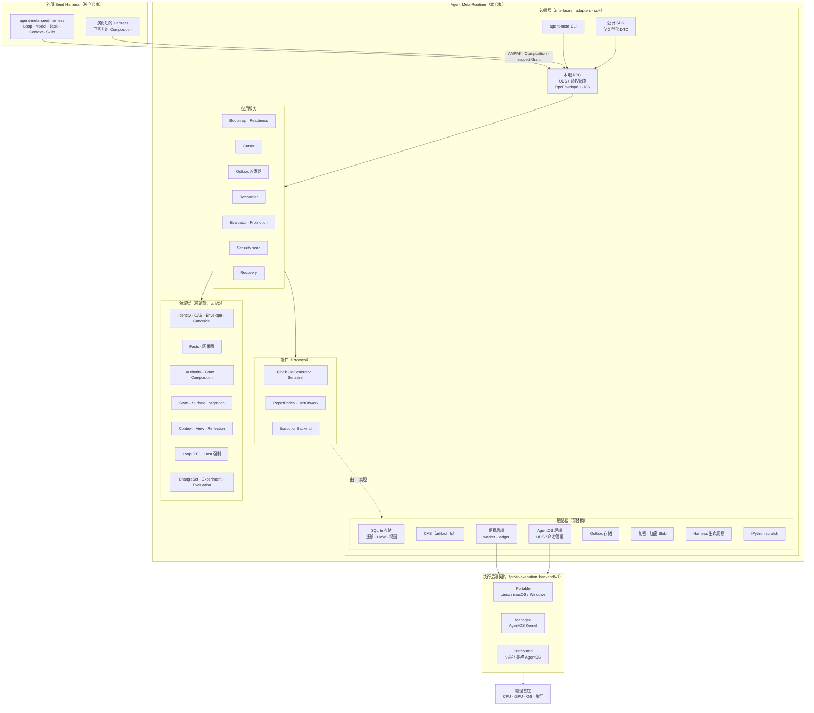
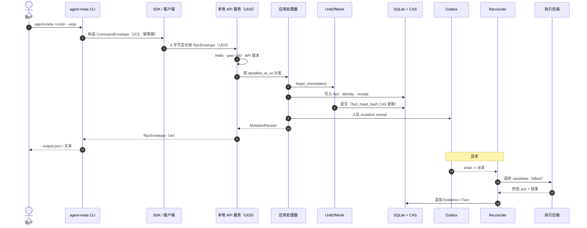

# agent-meta-runtime

**反射式 + 可演化的 Agent 元运行时** —— 让 Agent 系统自身成为一等对象：组成、能力、制品、状态、权威、事实与证据皆可观测、可组合、可版本化、可演化。

英文版见 [README.md](README.md)。规范基线见 [`docs/Agent_Meta_Runtime_Requirements_Design_v0.1.md`](docs/Agent_Meta_Runtime_Requirements_Design_v0.1.md)；分步实施计划见 [`docs/plans/v0.1/README.md`](docs/plans/v0.1/README.md)；逐 ID 可追溯性见 [`docs/spec/v0.1-scope-and-traceability.md`](docs/spec/v0.1-scope-and-traceability.md)。

## 它是什么

本运行时是一个单用户、本地运行的 Python 服务（CPython 3.12），通过本地 RPC 通道暴露冻结的 Public API v1（Linux/macOS 使用 Unix Domain Socket，Windows 使用 Named Pipe）。外部 Seed Harness（位于独立仓库 `agent-meta-seed-harness`）以及 `agent-meta` CLI / Python SDK 是仅有的预期消费者。不固化 Planner、Memory、Skill 或 Subagent 结构 —— 这些都属于 Harness，核心运行时绝不内置。

三个一等轴贯穿整个设计：

- **自我模型（Self-Model）** —— Composition、Capability、Artifact、Managed State、Context、Authority、RuntimeView。
- **自我历史（Self-History）** —— Fact、Action、Invocation、Evidence、Causal Graph、World。
- **自我转化（Self-Transformation）** —— ChangeSet、Experiment、Evaluation、Evolution、Governance、Succession。

## 架构



分层规则（§41.3）：`domain → ports → application`，适配器、接口与 SDK 配置在边缘。领域层绝不引入适配器、`sqlite3`、IPython 或 gRPC。

## 核心流程

### 1. 启动与一次 CLI mutation



一次命令的幂等声明、规范变更、Fact、Outbox 项与 meta revision 在同一个 `BEGIN IMMEDIATE` 事务中提交。Fact 分配连续 seq 并按 hash 链接（§41.35）；`fact_head_hash` 在末尾以 CAS 方式更新。

### 2. Harness Loop 的一次 turn（Host 强制）

```mermaid
sequenceDiagram
    autonumber
    participant Loop as 外部 Harness Loop
    participant Host as Meta-Runtime Host
    participant Prov as 模型 Provider
    participant BE as 执行后端
    participant Store as SQLite + CAS
    participant World as World / Effect 日志

    Loop->>Host: turn（input · budget · context）
    Host->>Host: 校验 authority + TaskBudget
    Host->>Prov: 模型调用（消耗一个 step）
    Prov-->>Host: Response（TextPart / JsonPart / ToolCallPart）
    Host->>Host: 校验响应（终态 vs tool_calls）
    alt 终态响应
        Host->>Store: 记录 TerminalResult + Fact
        Host-->>Loop: TurnResult（终态）
    else 包含 tool_calls
        loop 逐个 ToolCallPart（串行）
            Host->>BE: 派发 Candidate（effect）
            BE-->>Host: 终态 ack + 效果
            Host->>Store: 追加 Fact + Evidence
            opt 声明了 World
                Host->>World: 观测 effect
            end
        end
        Host-->>Loop: TurnResult（已消耗 steps）
    end
```

一次 turn 等于一次 Model Invocation 加上对所有 tool call 的串行处理；一次模型调用与一次 tool call 各消耗一个 `step`，因此 `max_steps` 为二者之和。唯一的副作用路径是 Provider 规范化后的 `tool_calls` parts（按响应顺序），自由文本永远不会被解析为命令（§41.53）。

## 源码布局

```
src/agent_meta_runtime/
├── domain/          # 纯领域：identity、facts、authority、state、loop、evolution
├── ports/           # 仅协议：Clock、IdGenerator、Serializer、repos、backend
├── application/     # 用例：bootstrap、outbox、reconciler、cursor、recovery、evaluator
├── adapters/        # 边缘：sqlite、cas、crypto、harness、scratch_ipython、
│                    #       execution_portable、execution_agentos、system_runtime
├── interfaces/
│   ├── cli/         # `agent-meta` 命令行接口
│   └── local_api/   # UDS / 命名管道 RPC 服务端与 peer 认证
├── protocols/       # protobuf 协议：public_api/v1、execution_backend/v1、transport
└── sdk/             # 公开 Python SDK（仅类型化 DTO）
```

## 安装

```sh
pip install agent-meta-runtime
```

当前 0.0.1 版本仅用于预留 PyPI 名称；功能实现在 0.1.0 落地，对齐 v0.1 设计基线。

## 许可证

MIT。
